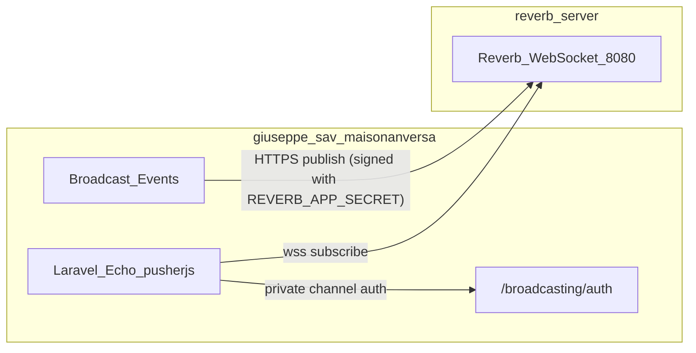

# Maison Anversa — Reverb Server

Dedicated [Laravel Reverb](https://laravel.com/docs/13.x/reverb) WebSocket service for
**giuseppe_sav_maisonanversa**. This repository runs only the Reverb process; the main
Laravel application (separate repo) dispatches broadcast events, authorizes private
channels (`/broadcasting/auth`) and hosts the Laravel Echo client.

## Architecture



| App / repo | Domain | Purpose |
|---|---|---|
| `giuseppe_sav_maisonanversa` | `maisonanversa.maktechlaravel.cloud` | Main Inertia app |
| `giuseppe_sav_maisonanversa_reverb_server` (this repo) | `ws.maisonanversa.maktechlaravel.cloud` | `php artisan reverb:start` on port 8080 |

| Responsibility | This repo | Main app |
|----------------|-----------|----------|
| WebSocket server | Yes | No |
| `REVERB_APP_*` credentials | Must match | Must match exactly |
| `BROADCAST_CONNECTION=reverb` | No | Required |
| `routes/channels.php` | Stub only | Required |
| Broadcast events | No | Yes |
| Laravel Echo | No | Yes |

## Local development

```bash
cp .env.example .env
php artisan key:generate

# Local values (must equal giuseppe_sav_maisonanversa/.env):
# REVERB_APP_ID / REVERB_APP_KEY / REVERB_APP_SECRET
# REVERB_HOST=127.0.0.1  REVERB_PORT=8080  REVERB_SCHEME=http
# REVERB_ALLOWED_ORIGINS=127.0.0.1,localhost

php artisan reverb:start --debug
```

Reverb listens on `ws://127.0.0.1:8080`. Then open the main app's admin
**Realtime console** (`/nl/admin/realtime`) to verify the connection.

## Docker / Coolify

```bash
docker build -t maison-reverb .
docker run -p 8080:8080 --env-file .env maison-reverb
```

Coolify:

1. Create an app from this repo (Dockerfile deploy, port **8080**).
2. Attach domain `https://ws.maisonanversa.maktechlaravel.cloud`.
3. Paste env from `live.env.example` and fill in `REVERB_APP_*` (keep the real values
   in the git-ignored `live.env` / your secrets manager — never commit them).
4. Traefik terminates TLS and upgrades WebSockets — no custom labels needed.

Inject environment variables at runtime; do not bake secrets into the image.

## Environment variables

| Variable | Purpose |
|----------|---------|
| `REVERB_APP_ID` | Application ID (shared with main app) |
| `REVERB_APP_KEY` | Public key for WebSocket clients |
| `REVERB_APP_SECRET` | Secret for signing broadcast API requests |
| `REVERB_SERVER_HOST` | Bind address (`0.0.0.0` in Docker) |
| `REVERB_SERVER_PORT` | Bind port (default `8080`) |
| `REVERB_HOST` | Public hostname (`ws.maisonanversa.maktechlaravel.cloud`) |
| `REVERB_PORT` | Public port (`443` behind Traefik) |
| `REVERB_SCHEME` | `https` in production |
| `REVERB_ALLOWED_ORIGINS` | Bare hostnames of pages that may connect (main app host, not `ws.*`) |

## Main app integration (`giuseppe_sav_maisonanversa`)

```dotenv
BROADCAST_CONNECTION=reverb
REVERB_APP_ID=<same as reverb_server>
REVERB_APP_KEY=<same>
REVERB_APP_SECRET=<same>
REVERB_HOST=ws.maisonanversa.maktechlaravel.cloud
REVERB_PORT=443
REVERB_SCHEME=https

# Vite build-time (Coolify build args)
VITE_REVERB_APP_KEY="${REVERB_APP_KEY}"
VITE_REVERB_HOST="${REVERB_HOST}"
VITE_REVERB_PORT="${REVERB_PORT}"
VITE_REVERB_SCHEME="${REVERB_SCHEME}"
```

Echo dials `wss://ws.maisonanversa.maktechlaravel.cloud:443`. Channel auth stays on
`https://maisonanversa.maktechlaravel.cloud/broadcasting/auth`.

## Verification

Open `https://maisonanversa.maktechlaravel.cloud/nl/admin/realtime` (admin, permission
`realtime.view`): status must be **Connected**, and both the public ping and the private
test event must arrive.

## Documentation

- [Laravel Broadcasting](https://laravel.com/docs/13.x/broadcasting)
- [Laravel Reverb](https://laravel.com/docs/13.x/reverb)
